# Spatial Image Enhancement

**Image Processing Homework 1**  
Student name: [Placeholder]  
Student ID: [Placeholder]  
Due date: November 11, 2026  
Submission date: [Placeholder]

## Technical Description

### Objectives and input

This homework enhances six dark, 600 × 400, 8-bit grayscale PNG images. It compares a power-law transformation, global histogram equalization, and a two-stage gamma and contrast-stretch pipeline. Each result remains a 600 × 400 mode-L PNG. The images are 1-1.png through 1-6.png. The code also saves a copy of each original, gamma trials, original and equalized histograms, comparison figures, and a JSON measurement record.

### Mathematical background and algorithms

Let r be an integer input intensity in [0,255], let N = 240,000 pixels, and let round(x) mean floor(x + 0.5) for nonnegative x. All mappings are calculated at integer intensities and applied through explicit pixel loops. Outputs are clamped to [0,255].

**Gamma transformation.** For gamma greater than zero, s = round[255 (r/255)^gamma]. A gamma below 1 expands dark intensities. The implementation builds a 256-entry lookup table with the equation and assigns the mapped value to every pixel. Values 0.3, 0.5, and 0.7 were saved for every image before selecting one value per scene.

**Histogram equalization.** The implementation counts h(k) = number of pixels with intensity k, for k = 0,...,255. It calculates p(k) = h(k)/N and C(k) = sum from j=0 to k of p(j). It uses the CDF-min-adjusted mapping s(k) = round[255 (C(k) - C_min)/(1 - C_min)], where C_min is the first nonzero CDF value. The mapping is clamped to [0,255]. If all pixels have one intensity, the output is an unchanged copy, avoiding division by zero. This is global equalization, so distinct input levels can map to the same output level; the resulting histogram is not necessarily flat.

**Combined enhancement.** Gamma transformation is applied first. A second, distinct point operation performs percentile contrast stretching on the gamma image. The lower endpoint L is the first intensity whose cumulative count reaches 1% of pixels; the upper endpoint H reaches 99.5%. The mapping is s = clamp(round[M (r-L)/(H-L)], 0, M). The output ceiling M is 255 except for image 1-4, for which it is 220. If H <= L, stretching returns the gamma image unchanged. Percentile endpoints reduce the effect of outliers but intentionally clip values outside the selected interval. The ceiling of 220 preserves sky gradation in 1-4. No convolution or sharpening is used; the selected combination is gamma plus contrast stretching, both spatial-domain intensity enhancement methods.

### Implementation and execution flow

1. Parse the input directory, output directory, and optional per-image gamma JSON file. Check that all six files exist and are 600 × 400 mode-L images before writing output.
2. Read each image and count intensities with explicit nested pixel loops. Create trial gamma outputs for 0.3, 0.5, and 0.7.
3. Apply the selected gamma mapping, CDF-min equalization, and gamma followed by percentile stretching.
4. Save PNGs, two fixed-axis histograms for each image, a four-panel comparison with a common 0–255 display range, and measured values in results.json.
5. Run the automated tests; package the same CLI with PyInstaller for Windows execution.

The histograms use the same x range of 0–255 and the same y maximum within each original/equalized pair. Every comparison panel uses vmin=0 and vmax=255, so display scaling cannot make one method appear brighter by changing the plotting limits.

### External library calls and their limited roles

| Library calls | Role | Why the homework algorithm remains manual |
|---|---|---|
| NumPy `asarray`, `empty`, `array_equal` | Store images as 2-D uint8 arrays and verify equality | No enhancement, histogram, CDF, or convolution API is called. |
| Pillow `Image.open`, `Image.fromarray`, `Image.save` | Decode and encode grayscale PNG files | They do not calculate enhancement mappings. |
| Matplotlib `use`, `subplots`, `bar`, `imshow`, `savefig`, `close` | Draw histograms and fixed-scale comparison figures | Histogram counts are supplied by the manual counting loop. |
| pytest `raises`, `approx`, parameterization | Execute numerical and edge-case assertions | Tests do not process the homework images. |
| PyInstaller command | Bundle Python and dependencies into a Windows executable | It packages the CLI without changing the algorithms. |
| reportlab classes and `build` | Render this editable report source as a PDF | It is used only for report layout. |

### Parameter selection

Visual inspection of all 18 gamma trial images guided the choices below. Gamma 0.3 revealed more structure in the very dark bookshelf, laundry, and shelf scenes (1-2, 1-5, 1-6). Gamma 0.5 retained more tonal separation in 1-1, 1-3, and 1-4; 0.3 made some bright surfaces look flat. Gamma 0.7 was generally too dark for these inputs. The combined stretch uses the same percentiles on all images. Its output ceiling changes only for 1-4 because a 255 ceiling made the sky too pale in the visual comparison.

| Image | Selected gamma | L to H after gamma | Combined ceiling M |
|---|---:|---:|---:|
| 1-1 | 0.5 | 0 to 115 | 255 |
| 1-2 | 0.3 | 48 to 161 | 255 |
| 1-3 | 0.5 | 36 to 194 | 255 |
| 1-4 | 0.5 | 23 to 106 | 220 |
| 1-5 | 0.3 | 48 to 152 | 255 |
| 1-6 | 0.3 | 48 to 146 | 255 |

## Experimental Results

The mean and population standard deviation below describe intensity distributions, not perceived quality. They are calculated from manual histogram counts. The percent at zero or 255 exposes clipping; the figures provide the visual check.

| Image | Original mean / SD | Gamma mean / SD | Equalized mean / SD | Combined mean / SD | Combined at 0 / 255 |
|---|---:|---:|---:|---:|---:|
| 1-1 | 19.36 / 12.96 | 64.41 / 27.97 | 129.13 / 75.00 | 142.74 / 61.98 | 1.905% / 0.552% |
| 1-2 | 20.31 / 14.06 | 111.71 / 29.06 | 129.65 / 73.29 | 144.29 / 63.31 | 3.430% / 0.544% |
| 1-3 | 52.34 / 34.41 | 107.95 / 41.17 | 129.29 / 72.93 | 116.15 / 66.35 | 4.885% / 0.855% |
| 1-4 | 28.48 / 13.02 | 81.93 / 23.09 | 132.04 / 76.00 | 156.23 / 61.04 | 1.153% / 0% |
| 1-5 | 12.69 / 8.80 | 98.06 / 22.94 | 132.10 / 73.07 | 123.32 / 52.95 | 3.300% / 0.565% |
| 1-6 | 18.92 / 10.45 | 111.65 / 23.97 | 130.56 / 73.67 | 166.08 / 60.88 | 2.155% / 0.746% |

### Image 1-1

The plush figure and folded cloth become visible with gamma. Equalization reveals more wall texture but also a grainier background. The combined image retains useful contrast with less apparent grain than equalization.

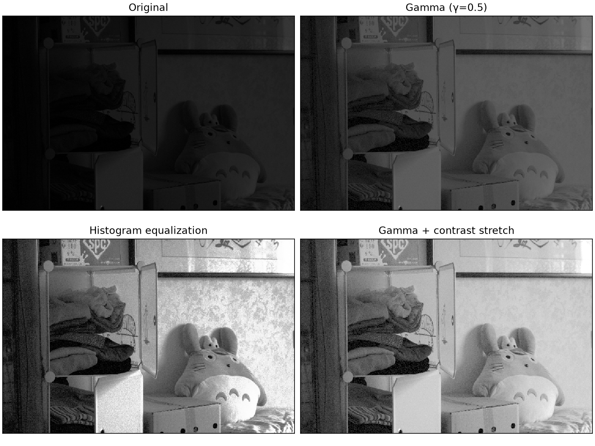

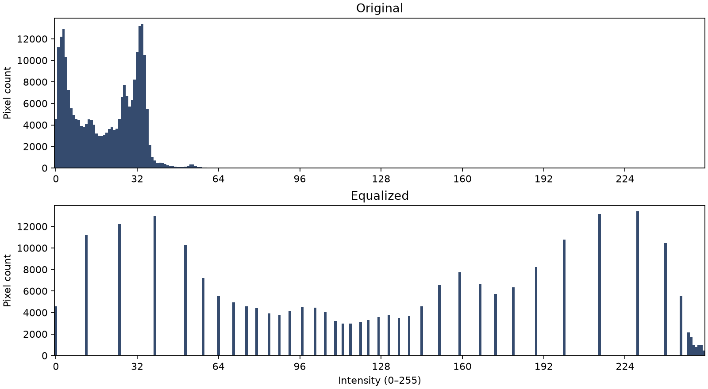

### Image 1-2

Gamma 0.3 lifts dark book spines. Equalization gives the strongest separation but raises grain around the shelf. The combined output makes lettering and book edges easier to see while clipping 3.43% to black.

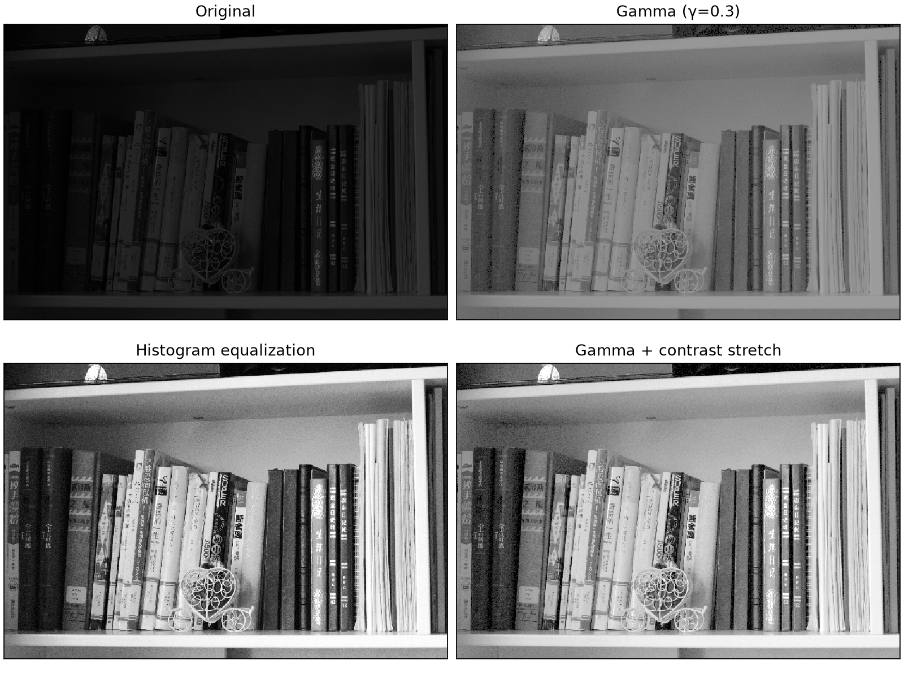

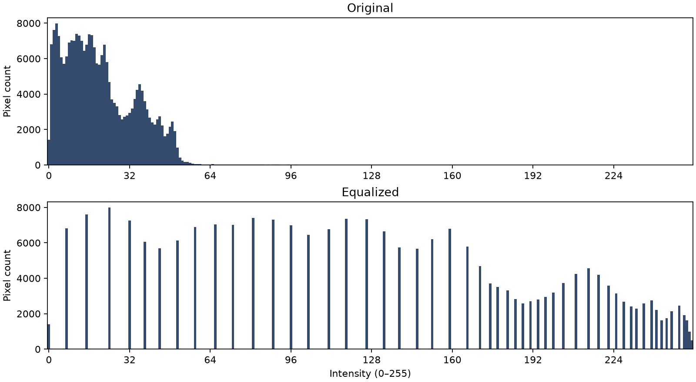

### Image 1-3

The original already has a wider range than the other inputs. Gamma 0.5 keeps the white figure controlled. Equalization improves dark-object separation but brightens the wall and white figure strongly. Combined stretching leaves 4.885% at black and can lose the darkest detail.

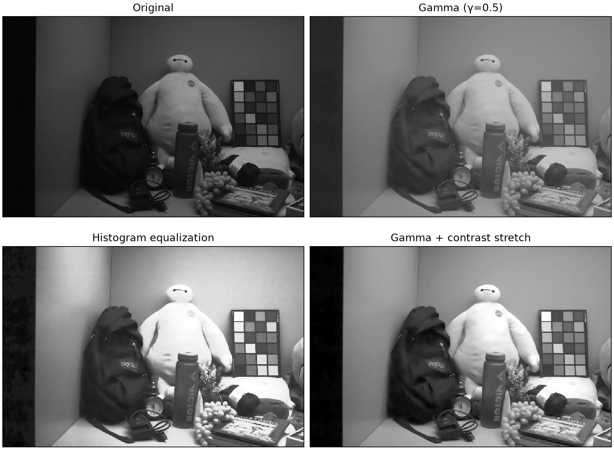

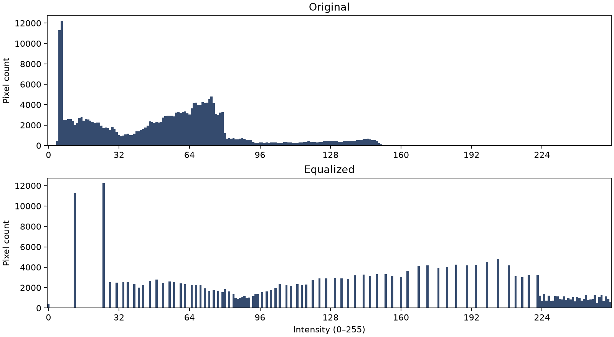

### Image 1-4

The skyline becomes clearer with all methods. Equalization gives strong local-looking structure in the clouds but also visibly amplifies sky noise. A full-range combined trial washed out the sky; the reported ceiling of 220 leaves more visible gradation.

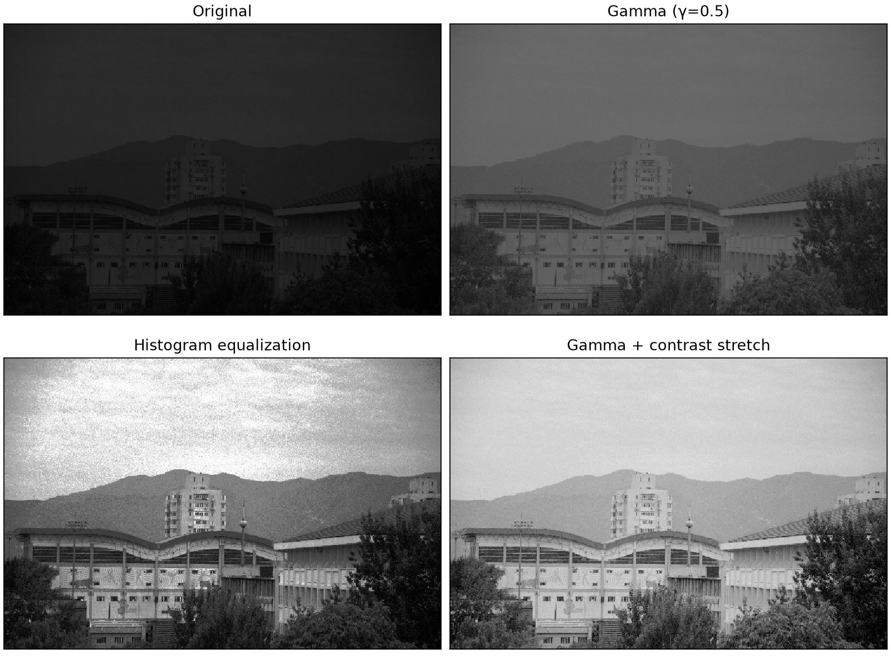

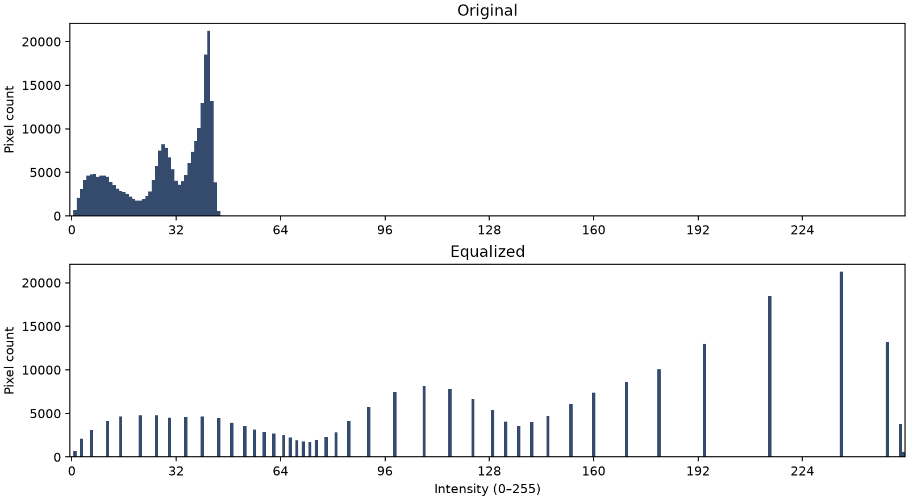

### Image 1-5

Gamma 0.3 reveals the washing machines without forcing white surfaces to maximum intensity. Equalization raises floor and wall noise substantially. Combined stretching improves machine edges and floor separation, with some dark-region clipping.

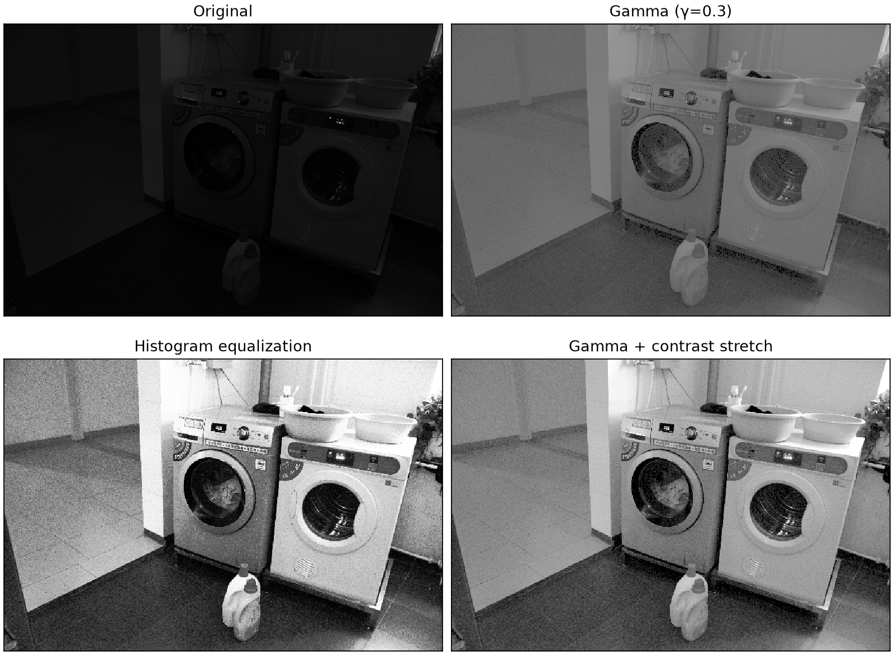

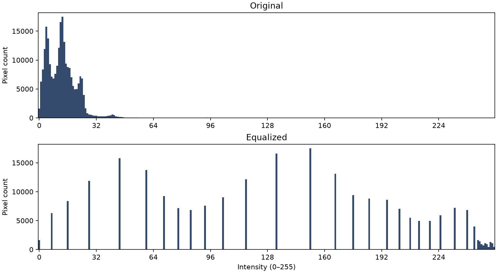

### Image 1-6

Gamma 0.3 makes shelf contents visible while retaining modest contrast. Equalization separates many small objects but produces a harsher, noisier appearance. The combined result is brighter and clearer in dark compartments, although highlights and noise need caution.

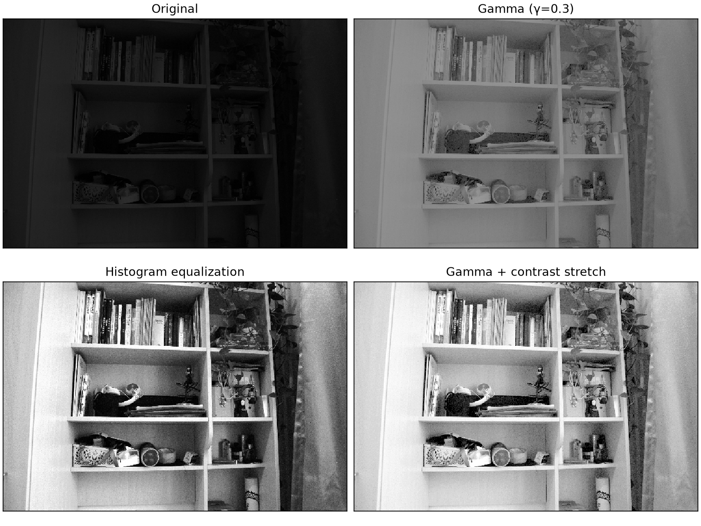

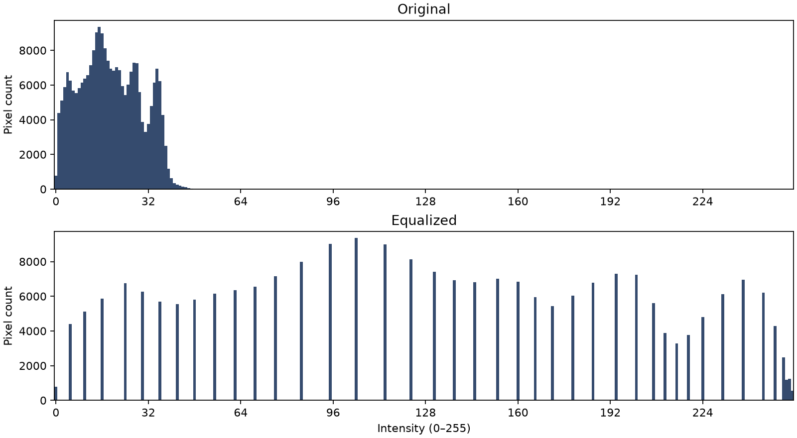

## Discussions

Gamma correction is monotone and controllable. It lifts dark intensities without forcing the image to use the full 0–255 range, but it may leave a narrow histogram and low contrast. Histogram equalization derives its mapping from the image distribution and usually spreads intensities more widely; in these images it can over-emphasize noise, flatten some surfaces, and change the balance between shadow and highlight detail. A larger mean is not evidence of better quality: 1-4's uncapped combined trial was brighter but visibly lost sky gradation.

The combined sequence adds contrast to the gamma-lifted image. The 1st and 99.5th percentiles limit outlier influence, but clipping is real: the combined 1-3 output has 4.885% pixels at zero. Noise can be amplified when narrow low-intensity intervals are expanded, especially in smooth walls and sky. The output ceiling for 1-4 reduces white saturation but also sacrifices some dynamic range. No single technique is best in every scene; gamma alone is the safest when smoothness and tonal restraint matter, while equalization or stretching is useful when stronger separation is needed.

Automated tests cover known gamma values, manual counts, PMF normalization, CDF monotonicity, CDF-min mapping, combined order, bounds, mode and dimensions, invalid input, and all-black, all-white, and constant-level images. On November 1, 2026, `uv run python -m pytest -q` reported **11 passed**. The one-file Windows executable built with `uv run pyinstaller` and ran outside the project with explicit input and output paths. Its 18 enhanced PNGs were pixel identical to the Python outputs; all were 600 × 400 mode L. A missing-input run returned a descriptive error and exit code 1. A Python-free Windows machine was not available for a separate installation test.

## References and Appendix

1. Course slide deck, `Ch00.pdf`, page 11, "Homeworks" (required report sections).
2. OpenCV documentation, "Histogram Equalization," https://docs.opencv.org/4.x/d5/daf/tutorial_py_histogram_equalization.html (theory only; its enhancement functions are not used).
3. OpenCV documentation, "Intensity Transform," https://docs.opencv.org/4.3.0/dc/dfe/group__intensity__transform.html (power-law terminology only).
4. Astral, "Running commands," https://docs.astral.sh/uv/concepts/projects/run/.
5. PyInstaller, "Using PyInstaller," https://www.pyinstaller.org/en/stable/usage.html.

### Reproduction

From the submission root on Windows 11 with uv and Python 3.12 available: run `uv sync --python 3.12`, then `uv run python -m pytest -q`, then `uv run python -m spatial_image_enhancement --input HW1_test_image --output outputs`. To rebuild the executable, run `uv run pyinstaller --onefile --name SpatialEnhancement --noconfirm --clean run_homework.py`. To use the executable from another directory, run `SpatialEnhancement.exe --input <image-folder> --output <result-folder>`. For a PDF refresh after editing this Markdown source, run `uv run python report/build_report.py`.

The project uses Python 3.12, NumPy, Pillow, Matplotlib, pytest, PyInstaller, and reportlab (the last four are development dependencies where appropriate). It does not use a ready-made enhancement or histogram equalization API. `outputs/results.json` contains the complete measured values and gamma trial statistics. The original six PNG files are preserved byte-for-byte in `HW1_test_image`.
